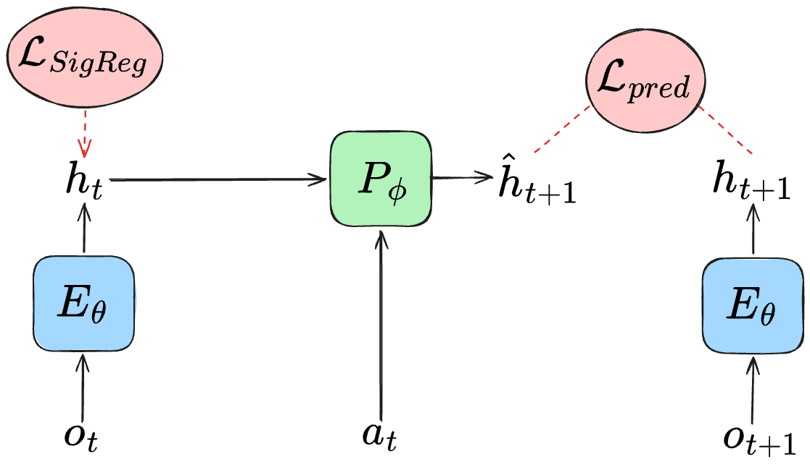
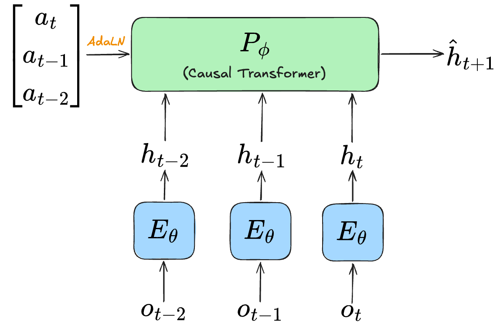

World models predict the next state of the world given an action performed on the current state. That capability, by itself, is not tremendously valuable, but it may be a critical component for solving difficult problems, such as those in planning and decision-making. A world model enables an autonomous decision-making function, or *policy*, to perform *model-based planning*, where the policy recieves *foresight* by understanding the consequences of its actions **before acting**. Using foresight, model-based planners should be able to make better decisions and generalize to challenging tasks / environments it was not trained for. The ability to generalize is always important for AI systems, but it’s arguably even more important in a world where policies operate autonomously, especially in collaboration with humans, where poor actions have the potential to cause serious harm.

It feels like there are an infinite number of ways and philosophies around designing world models. The reality is that we don't know which approach will work the best, and it’s possible that different approaches may be better suited for different downstream world model use cases (e.g., world models used to RL train policies may look different than those used for model-based control). **One major design choice for world models is the space (or representation) in which the world model is predicting the next state in.** *Generative world models* predict the next observation directly in the observation space (e.g., text or image). However, accurately predicting an observation requires modeling every detail, including information that may be unpredictable or irrelevant. This may impose a stronger objective than is necessary for world modeling. Thus, a different approach is *latent world models*, where the next state is predicted in the latent space. Latent world models should be faster than generative ones (it's faster to predict in a compressed latent space than to generate an image) and potentially contain more relevant information. However, there is a lack of observability: it is difficult for humans to debug or understand what the predicted latent state is.

&lt;Image or video showing the difference between the two&gt;

<!--Can use DINO-WM image for latent world model. Can put DOOM or one of the controllable Genie visualizations for generative world models.-->

Recent approaches for latent world models using the JEPA (joint embedding predictive architecture) framework show some promising results for model-based planning (TODO: footnote to some work). However, current implementations have an important limitation: there is no persistent memory. That is, the next state is always predicted from a fixed set of previous observations. Such architectures work well in *fully observable* settings, where one can infer the underlying environment state from the current (or a set of the past few) observations. As an example, the recent seminal approach from LeCun's group, **LeWorldModel** (LeWM), specifically predicts the next latent state conditioned on the past three observations.

<figure class="post-figure post-figure--pair">
  

    

      
      <figcaption><strong>General JEPA latent world model architecture.</strong> An encoder \(E_\theta\) maps from observation \(o_t\) to latent state \(h_t\). An action-conditioned next-state predictor \(P_\phi\) predicts the next state \(\hat{h}_{t+1}\). A predictive loss \(\mathcal{L}_{\mathrm{pred}}\) is the main training objective, and \(\mathcal{L}_{\mathrm{SigReg}}\) prevents representational collapse.</figcaption>
    

    

      
      <figcaption><strong>LeWorldModel architecture.</strong> The next-state predictor only conditions on the past three observations / actions.</figcaption>
    

  

</figure>

However, most real-world settings are *partially observable* (PO). The current observation is not enough to know everything about the underlying state. **Instead, a world model must reason over its memory of the past.** Consider a simple example: the PushT benchmark is fully observable, and a short history of observations is all one needs to predict the future state. Contrast this with a simple partially observable variant (PO-PushT), where we occlude some portion of the view. If the agent is occluded for three or more observations, LeWM will not know where the agent is in the current state, which makes future state prediction impossible. We quantify this by testing our ability to recover the ground-truth state information from LeWM’s latent state on PushT and PO-PushT. Unsurprisingly, we see that LeWM performs poorer on PO-PushT.

&lt;Show example + experimental results&gt;

**This motivates the research question for this post: how should we add “memory” to latent world models, and does that help for partially observable environments?** There are two obvious approaches for longer memory LeWMs, inspired from language models. A recurrent architecture or a full attention architecture. Recurrence is less memory intensive but leads to longer computation time *if* there's a significant prefill component. Unlike language models, world models used for model-based planning typically *will not have a prefill stage*. The world model will initialize when the robot starts a task, and update it's memory as the robot (and world model) recieve new observations. This makes recurrence a natural solution to the problem. One natural limitation is the *recurrence bottleneck*, where information from the past must be compressed into a single (or a few) embedding, and in general, it may not clear a priori what information will be important to keep for the future.

Full attention architectures are memory intensive, but they can be fully parallelized and do not suffer from the same recurrent bottleneck. Instead, LLMs (which typically use a full attention architecture) are known to suffer from the long-context problem, and this issue must be certainly worse for world models used in model-based control, where context is continuously accomulated as the policiy operates. Recent open-source frontier LLMs are pursuing hybrid recurrent-attention architectures to solve the long-context problem, which makes me less bullish on full-attention architectures as a scalable, long-term solution. Like with LLMs, it's possible that world models eventually settle on some hybrid architecture. 

&lt;High-level recurrent vs. full attention architecture&gt;

This post first analyzes what happens if we increase the number of observations used by LeWM in the history. Then, we move to studying recurrence LeWM. Finally, we introduce and compare with full-attention LeWM.

## Recurrent LeWM

A lightweight, straightforward solution to add memory is via recurrence.

&lt;Show detailed architecture&gt;

However, training models with memory possibly demands a different training recipe than what is used in vanilla LeWM. Vanilla LeWM uses a window-based recipe. It samples B random windows, where each window consists of 4 consecutive observations (and B=128). Naively training our R-LeWM on this recipe may not work

&lt;Show results&gt;

Why? The point of R-LeWM is to track a recurrent state across an episode. The window-based recipe has no such recurrent state, the model always starts
